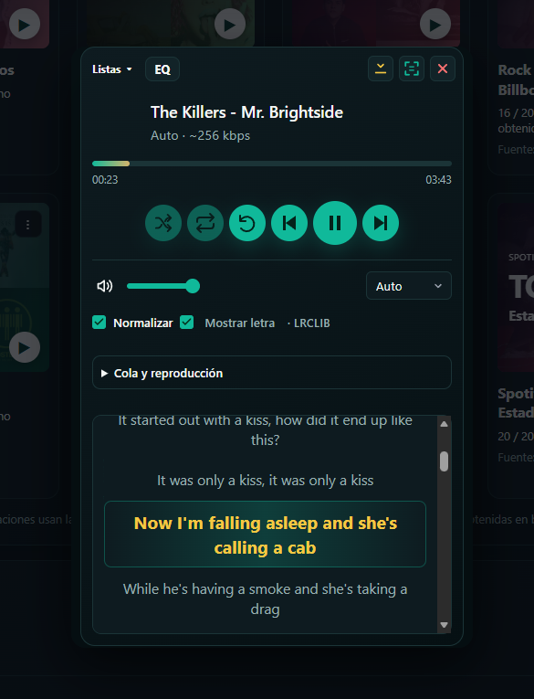
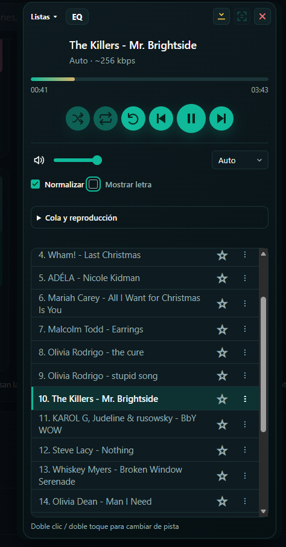
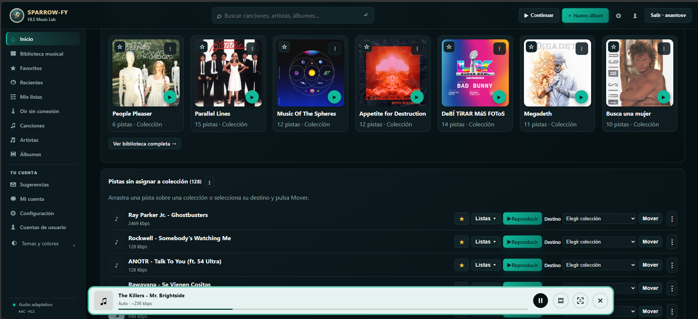
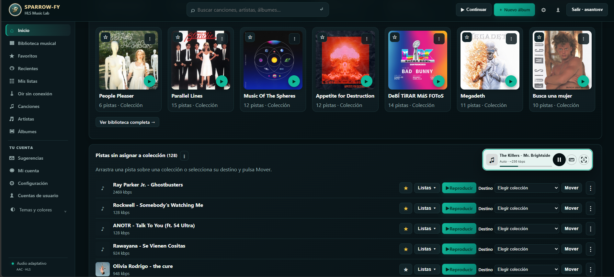
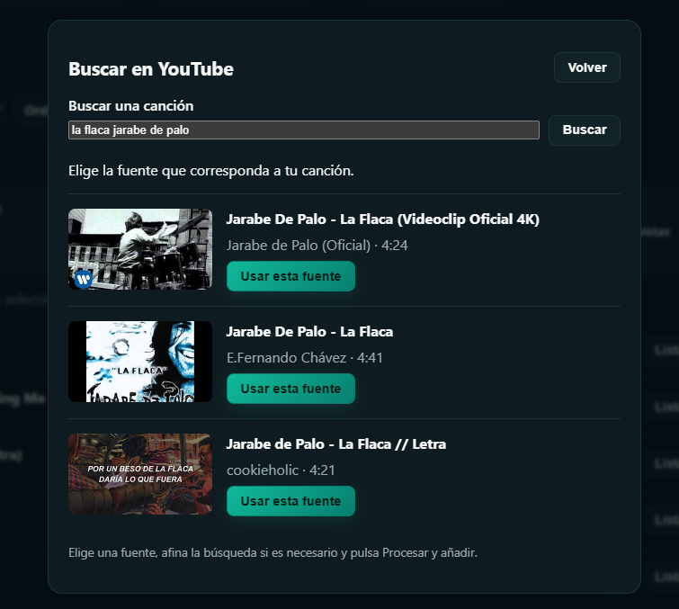
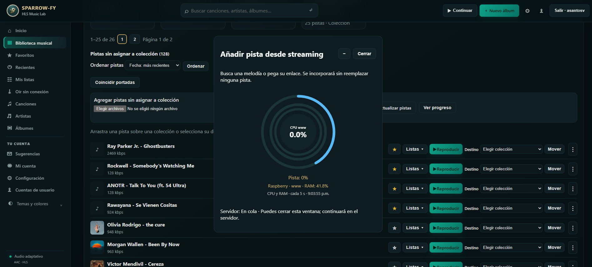
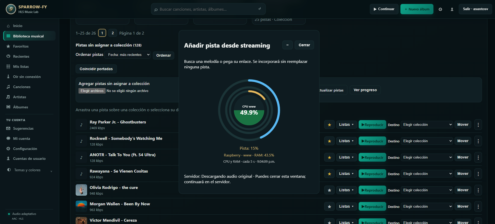
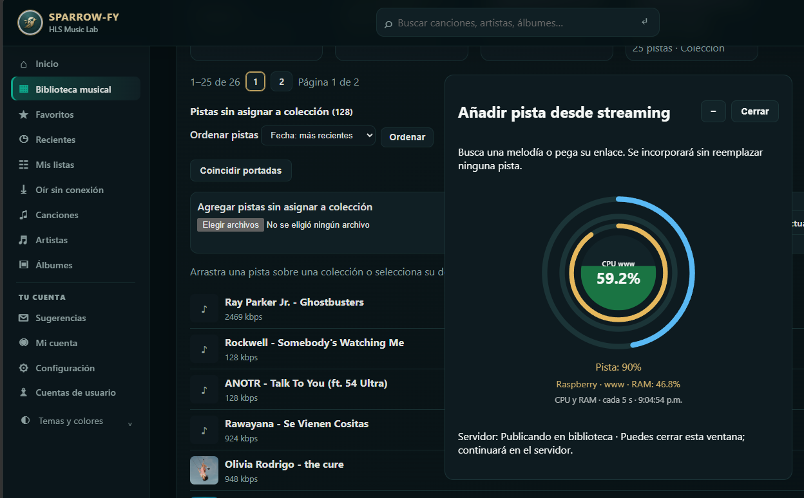

# Sparrow-Fy


[Español](#español) · [English](#english)

## Español

Sparrow-Fy es una biblioteca musical autohospedada con reproducción HLS adaptativa, favoritos, listas y descargas para oír sin conexión. La interfaz está disponible en español e inglés. El despliegue incluye la web en PHP y Apache, el catálogo SQLite, integraciones aisladas de Mornye y Spotify Charts y un instalador de worker para Windows.

### Puesta en marcha

Requiere Docker Compose con contenedores Linux. La imagen web admite Raspberry Pi ARM64 y Linux x86-64. En Docker Desktop x86-64, agrega `-f docker-compose.yml -f docker-compose.windows.yml` a las llamadas a Compose.

```sh
docker compose up -d --build --wait
docker compose exec www bash scripts/crear-admin.sh
```

Abre [localhost:8081](http://localhost:8081). El instalador del worker está en **Mi cuenta → Mi PC como worker** para administradores y gestores. Cada operador activa sus propias cuentas de Mornye y Spotify Charts. Consulta la [guía de despliegue](SPARROWFY.md) y el [contrato para Android](app/public/API_MOBILE_V1_OPENAPI.yaml).

Tu despliegue normal publica en **443** con letsencrypt usando el **80** para el challenge. Si estás detrás de CGNAT y no puedes abrir puertos, [publica el servicio con Cloudflare Tunnel](CLOUDFLARE_TUNNEL.md) como alternativa: `bash scripts/cloudflare-tunnel.sh start` (o `.\scripts\cloudflare-tunnel.ps1` en Windows). La misma guía explica cómo crear el primer administrador y cómo resetear su contraseña con `scripts/auth_reset_password.php`.

El repositorio es público e incluye el proyecto Android y el APK de depuración. El código del servidor y de la web se entrega **TAL CUAL**, con la [licencia Apache 2.0](LICENSE), los [créditos](NOTICE) y los [avisos de terceros](app/public/THIRD_PARTY_LICENSES.md).

## English

Sparrow-Fy is a self-hosted music library with adaptive HLS playback, favorites, playlists, and offline downloads. The interface is available in Spanish and English. This deployment includes the PHP/Apache web app, its SQLite catalog, isolated Mornye and Spotify Charts integrations, and a Windows worker installer.

### Getting started

Use Docker Compose with Linux containers. The web image supports Raspberry Pi ARM64 and Linux x86-64. On x86-64 Docker Desktop, add `-f docker-compose.yml -f docker-compose.windows.yml` to the Compose commands.

```sh
docker compose up -d --build --wait
docker compose exec www bash scripts/crear-admin.sh
```

Open [localhost:8081](http://localhost:8081). Administrators and library managers can download the worker under **My account → My PC as a worker**. Each operator activates their own Mornye and Spotify Charts accounts. See the [deployment guide](SPARROWFY.md) and [Android API contract](app/public/API_MOBILE_V1_OPENAPI.yaml).

Your normal deployment publishes on **443** with letsencrypt using **80** for the challenge. If you are behind CGNAT and cannot forward ports, [publish the service with Cloudflare Tunnel](CLOUDFLARE_TUNNEL.md) as an alternative: run `bash scripts/cloudflare-tunnel.sh start` (or `.\scripts\cloudflare-tunnel.ps1` on Windows). The same guide explains how to create the first admin and how to reset the password with `scripts/auth_reset_password.php`.

The repository is public and includes the Android project and the debug APK. The server and web app are provided **AS IS** under the [Apache 2.0 license](LICENSE). See the [credits](NOTICE) and [third-party notices](app/public/THIRD_PARTY_LICENSES.md).

## Galería / Gallery

> **Nota sobre las pruebas.** Las descargas que aparecen en las capturas se realizaron únicamente para probar el flujo de importación. Los archivos descargados se eliminaron porque no se contaba con los derechos de uso y reproducción.
>
> **Testing note.** The downloads shown in the screenshots were made solely to test the import workflow. The downloaded files were deleted because we did not have the rights to use or play them.

### Reproductor / Player

| Letras sincronizadas / Synchronized lyrics | Cola de reproducción / Playback queue |
| --- | --- |
|  |  |

### Biblioteca y minirreproductor / Library and mini player





### Selección de fuente e importación / Source selection and import

| Elegir fuente / Choose a source | En cola / Queued |
| --- | --- |
|  |  |

| Descarga del audio original / Downloading source audio | Publicación en la biblioteca / Publishing to the library |
| --- | --- |
|  |  |

### Oír sin conexión / Offline listening


Origen / Source · [Sparrow-Fy](https://sparrowfy.ddns.info)
