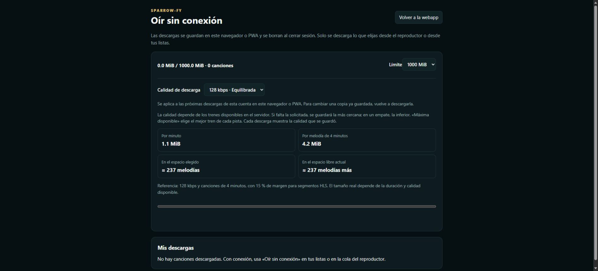

# Sparrow-Fy


[Español](#español) · [English](#english)

## Español

Sparrow-Fy es una biblioteca musical autohospedada con reproducción HLS adaptativa, favoritos, listas y descargas para oír sin conexión. La interfaz está disponible en español e inglés. El despliegue incluye la web en PHP y Apache, el catálogo SQLite, integraciones aisladas de Mornye y Spotify Charts y un instalador de worker para Windows.

### Puesta en marcha

Requiere Docker Compose con contenedores Linux. La imagen web admite Raspberry Pi ARM64 y Linux x86-64. En Docker Desktop x86-64, agrega `-f docker-compose.yml -f docker-compose.windows.yml` a las llamadas a Compose.

```sh
docker compose up -d --build --wait
docker compose exec www bash scripts/crear-admin.sh
```

Abre [localhost:8081](http://localhost:8081). El instalador del worker está en **Mi cuenta → Mi PC como worker** para administradores y gestores. Cada operador activa sus propias cuentas de Mornye y Spotify Charts. Consulta la [guía de despliegue](SPARROWFY.md) y el [contrato para Android](app/public/API_MOBILE_V1_OPENAPI.yaml).

El repositorio permanece privado hasta incorporar el APK completo y confirmar el enlace a su repositorio. El código del servidor y de la web se entrega **TAL CUAL**, con la [licencia Apache 2.0](LICENSE), los [créditos](NOTICE) y los [avisos de terceros](app/public/THIRD_PARTY_LICENSES.md).

## English

Sparrow-Fy is a self-hosted music library with adaptive HLS playback, favorites, playlists, and offline downloads. The interface is available in Spanish and English. This deployment includes the PHP/Apache web app, its SQLite catalog, isolated Mornye and Spotify Charts integrations, and a Windows worker installer.

### Getting started

Use Docker Compose with Linux containers. The web image supports Raspberry Pi ARM64 and Linux x86-64. On x86-64 Docker Desktop, add `-f docker-compose.yml -f docker-compose.windows.yml` to the Compose commands.

```sh
docker compose up -d --build --wait
docker compose exec www bash scripts/crear-admin.sh
```

Open [localhost:8081](http://localhost:8081). Administrators and library managers can download the worker under **My account → My PC as a worker**. Each operator activates their own Mornye and Spotify Charts accounts. See the [deployment guide](SPARROWFY.md) and [Android API contract](app/public/API_MOBILE_V1_OPENAPI.yaml).

The repository stays private until the complete APK is added and its repository link is confirmed. The server and web app are provided **AS IS** under the [Apache 2.0 license](LICENSE). See the [credits](NOTICE) and [third-party notices](app/public/THIRD_PARTY_LICENSES.md).

## Captura del sitio / Live site screenshot



Origen / Source: [Sparrow-Fy](https://sparrowfy.ddns.info).
