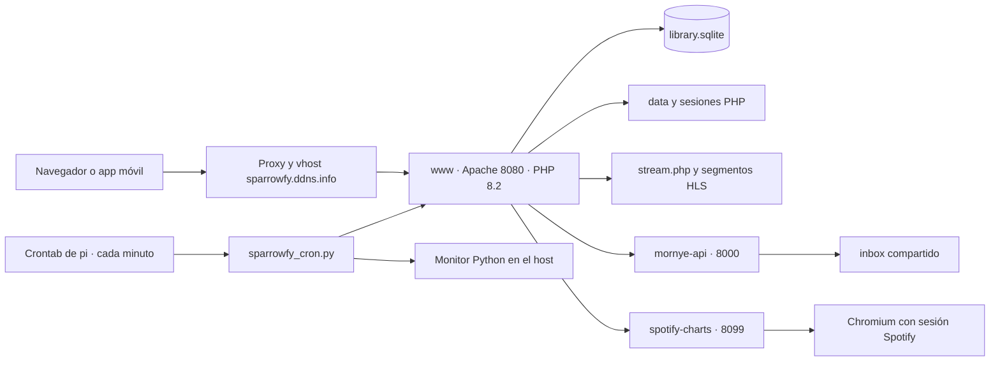
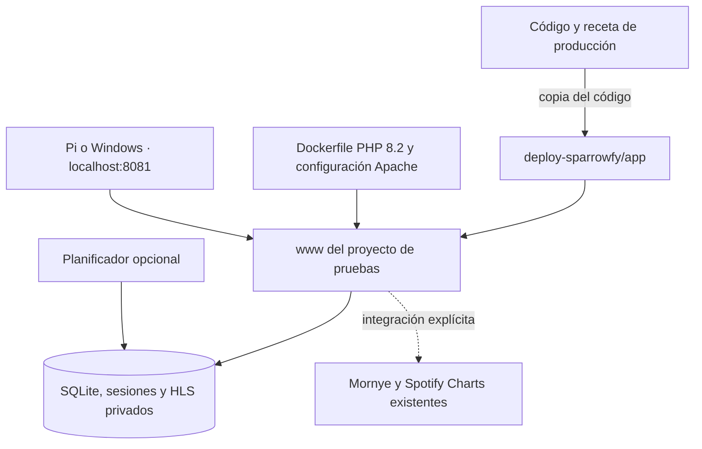
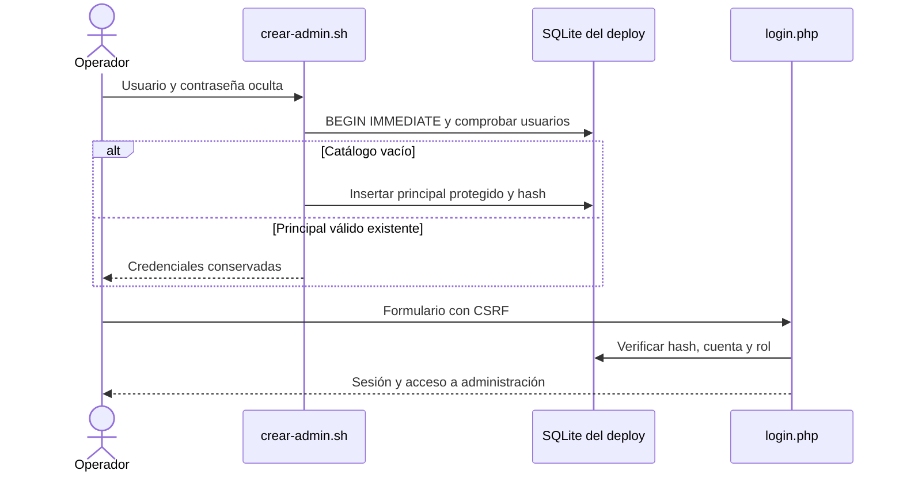
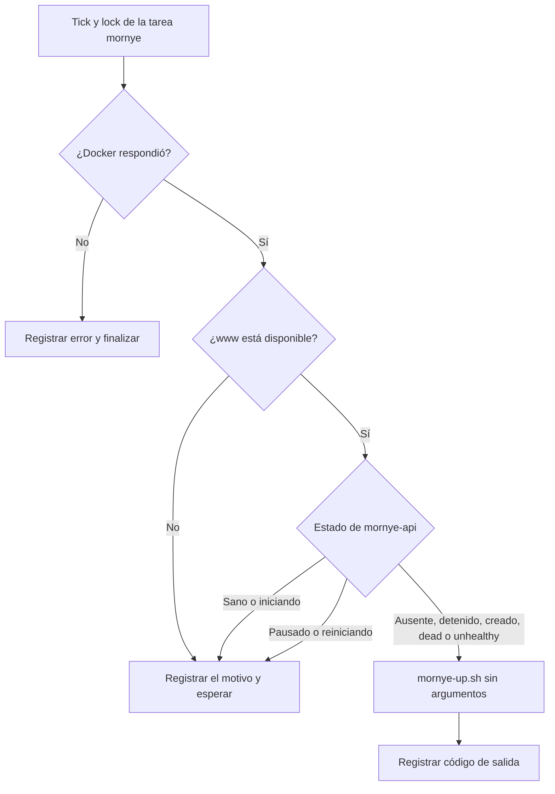

# Sparrowfy · inventario y despliegue paralelo

**Corte inicial del 22 de noviembre de 2026, hora de Ciudad de México.** Inspección realizada en `rpiathome` por SSH y en la sesión root `32613.opencode`. El origen es `/home/pi/docker/vaultwarden/www/audio`. El destino es su directorio hermano de despliegue `/home/pi/docker/vaultwarden/deploy-sparrowfy`, encontrado vacío antes de la implementación. Los valores de credenciales y el contenido del catálogo quedan fuera del inventario.

## Idiomas, worker para Windows y contrato Android

El selector 🇲🇽 Español / 🇺🇸 English está disponible antes del formulario de acceso y en Mi cuenta. La elección se conserva entre sesiones en el navegador mediante almacenamiento local y una cookie de idioma independiente de la autenticación. El catálogo inglés se sirve desde el propio sitio. Los nombres de los campos de la API móvil conservan su contrato.

En Mi cuenta → Mi PC como worker, los administradores y gestores pueden descargar el instalador para delegar procesamiento de audio en un PC Windows. Extrae el ZIP, ejecuta Instalar-worker.cmd con el usuario habitual y vincula el equipo con el código temporal generado por la cuenta gestora. El SHA-256 del ZIP es be9ee696171fe20e2093167841a5e8e1f950d6ba720e290233f088dd08411f0a. El contenido se entrega por worker_access.php?download=windows con sesión y permiso de gestión. La API móvil y su guía se documentan en API_MOBILE_V1_OPENAPI.yaml y MOBILE_DEVELOPER_HANDOFF.md.

## Actualización de instalación y acceso

Esta sección sustituye las instrucciones anteriores de conexión a las integraciones de producción. Compose levanta Mornye y Spotify Charts en la red privada de cada proyecto. Usa nombres de proyecto y puertos distintos para dos instalaciones sobre el mismo motor Docker. Cada proyecto guarda su propia configuración de Mornye y su perfil Chromium. La plantilla solo contiene calidad LOSSLESS, fallback desactivado y orden tidal, deezer, amazon, youtube, soundcloud. Cada administrador configura sus proveedores desde Mornye en http://127.0.0.1:18083 y completa las autorizaciones que le pida cada extensión. Los identificadores de proveedor dependen de su flujo de activación. No se distribuyen sesiones de la Pi.

En Sparrowfy abre Music Charts, pulsa «Conectar / renovar sesión», entra con tu propia cuenta desde http://127.0.0.1:16080/vnc.html y pulsa «Comprobar conexión». En una Pi remota usa un túnel SSH de loopback para acceder a esos puertos.

El primer administrador se crea desde la terminal local:

```powershell
docker compose exec www bash scripts/crear-admin.sh
```

El asistente pide usuario y contraseña dos veces; la contraseña debe tener entre 14 y 72 bytes. Llama a `scripts/auth_setup.php`, que solo crea la cuenta si la base está vacía. Para restablecer la contraseña de una cuenta existente usa:

```powershell
docker compose exec www bash scripts/crear-admin.sh --restablecer
```

También puedes hacerlo de forma no interactiva con `HLS_RESET_USER` y `HLS_RESET_PASSWORD` sobre `scripts/auth_reset_password.php`. Ese script no crea usuarios ni cambia el estado activo/inactivo. Verifica con `docker compose exec www php scripts/auth_diagnose.php`. La contraseña nunca se imprime. La guía completa está en [CLOUDFLARE_TUNNEL.md](CLOUDFLARE_TUNNEL.md).

### Publicación con Cloudflare Tunnel (alternativa para CGNAT)

El esquema normal publica el web en **443** con letsencrypt usando el **80** para el challenge. Ese es el recomendado cuando hay IP pública. Detrás de CGNAT no hay IP pública ni port forwarding posible, así que el 443/80 del host no es alcanzable desde internet. El perfil `tunel` de `docker-compose.tunnel.yml` es una **alternativa opcional**: invierte la conexión con `cloudflared tunnel --url http://www:8080` y entrega una URL temporal `https://*.trycloudflare.com`. El `8080` es el puerto **interno** del contenedor en la red de Docker; no sustituye ni modifica el 443/80 del host. El ejemplo de `drawio` solo sirve de referencia y sus puertos son relativos a ese proyecto.

En Linux, macOS o WSL:

```bash
bash scripts/cloudflare-tunnel.sh start
```

En Windows PowerShell:

```powershell
.\scripts\cloudflare-tunnel.ps1 -Action start
```

El script espera la URL en los logs y la imprime. Para verla después: `bash scripts/cloudflare-tunnel.sh url`; para detener el túnel: `bash scripts/cloudflare-tunnel.sh stop`. La URL cambia en cada reinicio y no es un secreto: la protección es el login de Sparrow-Fy. No expongas Mornye ni Spotify Charts por este túnel. Para un enlace fijo, usa un *named tunnel* con token de Cloudflare y una regla de Cloudflare Access; los pasos están en [CLOUDFLARE_TUNNEL.md](CLOUDFLARE_TUNNEL.md).

Comando manual equivalente al del ejemplo `drawio`:

```powershell
docker compose -f docker-compose.yml -f docker-compose.windows.yml -f docker-compose.tunnel.yml --profile tunel up -d tunnel
docker logs sparrowfy-deploy-tunnel-1 2>&1 |
  Select-String -Pattern 'https://[a-z0-9-]+\.trycloudflare\.com' -AllMatches |
  ForEach-Object { $_.Matches } | Select-Object -Last 1 -ExpandProperty Value
```

## 1. Producción observada

| Componente | Evidencia en la Pi | Función |
|---|---|---|
| Web | `www`, imagen `vaultwarden-www`, saludable. Apache escucha en 8080 dentro del contenedor. | El vhost `sparrowfy.ddns.info` sirve `/var/www/html/audio`. El bind real abarca todo `./www:/var/www/html`. |
| Aplicación | 85 archivos PHP de primer nivel o bajo `api/`, incluidos 45 `api_*.php`. 84 módulos en `lib/`. | `index.php?view=favorites`, `player.php?album=…`, `stream.php?track_id=…` y la API móvil. El segmento móvil está en `api/v1/segment.php`. |
| SQLite | `/mnt/ntfs1/shared/sparrowfy:/sparrowfy`. `auth.php` lee `HLS_MUSIC_LAB_SQLITE_DB`, con valor predeterminado `/sparrowfy/database/library.sqlite`. | Usuarios, catálogo, sesiones móviles y tareas. El compose también define `SQLITE_PATH`. |
| Estado web | `www/audio/data` está en el bind del sitio. `LAB_CONFIG` apunta a `data/config.json`. | Álbumes y configuración, cola, control del cron, cachés, tareas externas y datos privados de Mornye. |
| HLS y sesiones | El enlace `www/audio/hls_out` apunta a `/sparrowfy/hls_out`. `auth.php` usa `/var/lib/hlsml-sessions`. | Apache reescribe las rutas HLS hacia `stream.php` para comprobar la sesión. Las sesiones de PHP requieren un directorio privado escribible. |
| Mornye | `mornye-api`, imagen `ghcr.io/mornyeapp/mornye-python`, saludable. `PI_HOST:18081 → 8000`, red externa `vaultwarden_nginx`. | PHP usa `http://mornye-api:8000`. La sonda del servicio consulta `/api/v1/info`. Persiste la configuración en `www/audio/data/mornye-python:/config` y comparte `/mnt/ntfs1/shared/sparrowfy/inbox:/inbox`. |
| Spotify Charts | `spotify-charts`, imagen `sparrowfy-spotify-charts:1.0.0`, saludable. | Bridge Node/Chromium en `http://spotify-charts:8099`. El escritorio de login se publica en `127.0.0.1:6080`. La sesión Spotify persiste en el perfil Chromium de `/data/profile`. |
| Respaldo externo | `/mnt/xpg_ext4/backups_sparrowfy:/sparrowfy/xpg-backups` | Destino de respaldos del stack existente. |



### Cron instalado

La entrada activa está en el crontab de `pi`. El filtro de tareas Sparrowfy no devolvió entradas para `root` ni `asantosv`.

```cron
* * * * * /usr/bin/python3 /home/pi/docker/vaultwarden/www/audio/scripts/sparrowfy_cron.py
```

| Tarea | Comando del despachador | Frecuencia y cometido |
|---|---|---|
| processing | `sh scripts/run_processing_cron.sh` | Cada minuto intenta adquirir su lock. Ejecuta la cola PHP de procesamiento y rota el log al superar 2 MiB. |
| usage | `nice -n 10 php scripts/usage_rollup.php` | Cada minuto consolida el registro de uso pendiente. |
| resources | Python del host con `scripts/container_memory_monitor.py` | Cada minuto recoge información de recursos de los contenedores. |
| music-charts | `php scripts/music_charts.php` | Cada minuto invoca al planificador de listas. El tick del cron y la actualización efectiva son eventos distintos. |
| external-ai | `php scripts/ai_external_maintenance.php` | Cada minuto da oportunidad de ejecutar mantenimiento externo conforme a la configuración y la cola. |
| backup | `nice -n 15 python3 scripts/maintenance.py backup` | A partir de las 04:17 en `America/Mexico_City`. Registra un éxito por fecha y reintenta fallos a partir de una hora. Recupera la ejecución tras un reinicio si ya pasó la hora. |

El despachador arranca un hijo por trabajo. Cada hijo mantiene su propio `flock` no bloqueante en `data/cron-control`. Las tareas PHP y el respaldo usan `docker exec -u www-data -w /var/www/html/audio www`. Un segundo despachador que apuntara al mismo catálogo podría consumir la misma cola. El despliegue paralelo debe tener datos propios y las tareas auxiliares desactivadas por defecto.

### Dependencias y configuración

El Dockerfile de referencia es `/home/pi/docker/vaultwarden/Dockerfile.php.imagemagic`, basado en `php:8.2-apache-bookworm`. Las listas siguientes recogen los paquetes **activos** del archivo, agrupados por bloque de instalación.

- Primer bloque APT: `ca-certificates gnupg libpng-dev libjpeg62-turbo-dev libwebp-dev libfreetype6-dev libzip-dev zlib1g-dev libonig-dev libxml2-dev libcurl4-openssl-dev libssl-dev libmagickwand-dev imagemagick libgmp-dev curl wget git mariadb-client p7zip-full unrar-free unzip tar gzip xz-utils bzip2 sysstat ffmpeg webp libjpeg-turbo-progs pngquant optipng`.
- Repositorio Docker para Debian Bookworm: `docker-ce-cli`.
- Bloque PDF2Kindle/SQLite: `python3-fitz python3-ebooklib python3-pil python3-lxml calibre poppler-utils fonts-dejavu-core libsqlite3-dev`.
- Bloque yt-dlp: vuelve a instalar `ca-certificates wget unzip`. El Dockerfile original descarga un ejecutable aarch64. El despliegue multiplataforma necesita seleccionar el binario correcto para `amd64` y `arm64`.
- Análisis de audio: `python3-numpy`. Composer se copia de una imagen externa. GD se compila con FreeType, JPEG y WebP. Extensiones compiladas: `mysqli pdo_mysql mbstring zip gd bcmath exif xml curl gmp opcache`, más `imagick` mediante PECL. La instrucción explícita para compilar `pdo_sqlite sqlite3` está comentada. `docker exec www php -m` confirmó `imagick PDO pdo_mysql pdo_sqlite sqlite3`.

Mornye usa `mornye-up.sh` desde el directorio principal y `www/audio/deploy/mornye-python/{compose.yaml,.env}`. Sin argumentos espera la red y comprueba contenedor, red y API. Si coinciden y la API responde, termina. Cuando procede restaurarlo, el propio script ejecuta `up -d --force-recreate`. `--with-stack` también actúa sobre el stack principal. El parche de recuperación debe invocar únicamente la variante sin argumentos. El compose declara `MORNYE_IMAGE`, `MORNYE_DATA_DIR`, `MORNYE_CACHE_DIR`, `MORNYE_DOWNLOAD_DIR`, `MORNYE_REGISTRIES`, `MORNYE_PROGRESS_BARS`, `MORNYE_ANIMATED_ARTWORKS_ENABLED`, `HOME` y `TZ`. El script también usa `MORNYE_HOST_IP`, `WAIT_NETWORK_SECS` y `WAIT_API_SECS`. Los datos de sesión del proveedor se conservan en el volumen privado.

Spotify Charts se construye desde `spotify-charts/{Dockerfile,entrypoint.sh,server.js,package.json}` mediante `docker-compose.spotify-charts.yaml`. Configura `PORT=8099`, `PROFILE_DIR=/data/profile`, `STATE_DIR=/data`, `CHROME_PATH=/usr/bin/chromium`, `ALLOWED_ALIASES`, `NAV_TIMEOUT_MS`, `SSH_TARGET`, `USER_AGENT` y `TZ`. El login interactivo guarda la sesión en un volumen. `SPOTIFY_CHARTS_BRIDGE` configura la URL desde PHP. El endpoint de salud es `/health`.

La aplicación contiene clientes para AcoustID, MusicBrainz, Cover Art Archive, Apple Music/iTunes, Deezer, Billboard, YouTube, servicios de letras y proveedores de IA. Los anexos identifican las referencias estáticas. La presencia de un cliente en el código no certifica que su cuenta o integración esté activa.

### Configuración web y caché

Los archivos del stack incluyen `www.vhost.conf`, `www.ports.conf`, `www.apache2.conf`, `php-hardening.ini`, `php-session.ini` y `www.policy.xml`. Los ajustes de sesión incluyen cookies Secure, HttpOnly y SameSite=Lax. La regla del sitio desactiva índices, reescribe HLS y restringe el acceso a bases, respaldos y diagnósticos. El inventario de referencias `?v=` del anexo conserva versiones diferentes si dos páginas referencian el mismo asset con distintas claves.

## 2. Diseño del despliegue



La copia debe conservar las URL públicas y separar código de los datos de usuario. Para comparar el frontend anónimo se pueden comprobar redirecciones y controles de acceso. Las pruebas de reproducción autenticada requieren un catálogo de prueba y una cuenta propia. El endpoint móvil de salud abre SQLite y llama a una rutina de esquema antes de contestar. Por ello, el destino del deploy necesita una base inicializada y escribible, aislada de la biblioteca activa.

### Huella de referencia

| Archivo bajo `www/audio` | MD5 inicial |
|---|---|
| `index.php` | `9f9330185b4f14f0052dfd59f1aa2566` |
| `lib.php` | `3e9ac320e8607286e2ab58cddca5c06f` |
| `api/v1/index.php` | `2bfc9ccba67df74058c9d17571ac38be` |


### Verificación al cierre del inventario

Los tres MD5 coincidieron al repetir la lectura. Docker informó que `www` se inició el 22 de noviembre a las 04:42:04 UTC y su contador de reinicios era 0. El puerto TCP 8081 estaba libre en la Pi durante la consulta. Docker Desktop respondió desde Windows con motor Linux/amd64.

En el archivo activo `deploy/mornye-python/.env` solo se identificó el nombre `MORNYE_IMAGE`. El cliente de control PHP construye peticiones a la API interna. No se encontró un token de servicio en ese archivo. Las sesiones de proveedores que administra Mornye y los tokens Bearer de los clientes móviles pertenecen a flujos distintos.

La ruta de salud de producción puede purgar sesiones expiradas cuando se ejecuta `sf_mobile_sessions_schema()`. Para respetar el requisito de lectura, las comparaciones sobre producción deben usar archivos estáticos o evidencia ya existente para esa ruta. La prueba HTTP de salud se ejecutará contra el catálogo aislado.

## 3. Registro de ejecución

Al cierre del inventario se completaron las lecturas de producción. El build, los smoke tests y el parche de cron tienen su propio estado en el registro de la implementación. Una receta o un comando documentado no constituye una prueba ejecutada.

### Archivos del despliegue

```text
deploy-sparrowfy/
├── SPARROWFY.md
├── .dockerignore
├── .env.example
├── docker-compose.yml
├── docker-compose.windows.yml
├── app/
│   ├── public/       páginas PHP, API v1, assets, .htaccess, PWA
│   ├── src/          auth.php, lib.php y lib/*.php
│   ├── config/       settings.php y schema.sql
│   └── scripts/      tareas PHP/Python, alta de administrador y pruebas
├── images/php-imagemagic/
│   ├── Dockerfile, site.conf, www.policy.xml
│   ├── php-session.ini, php-hardening.ini
│   └── start.sh, health.sh, init_db.py, backup.py
├── scripts/          deploy.sh, backup.sh y smoke-test.sh
├── propuestas/       cron-mornye.patch y test_cron_mornye.py
└── volumes/          respaldos locales generados por backup.sh
```

La imagen instala las piezas de `app/` en `/var/www/html/audio` para conservar los includes basados en `__DIR__`. Apache deniega el acceso HTTP a las bibliotecas, scripts, respaldos y datos privados. La API móvil permanece en `app/public/api/v1/`. Los módulos de HLS, sesiones móviles, autenticación, Mornye y Charts conservan sus contratos de llamada. Se extrajeron de `lib.php` la configuración predeterminada, su carga y su guardado a `app/config/settings.php`. El service worker conserva la caché `sf-shell-v10`.

La imagen crea un catálogo vacío desde los 103 objetos de esquema extraídos de SQLite. Los datos del catálogo, las cuentas, las contraseñas, los estados de sesión y los archivos multimedia de producción quedan fuera del paquete. La inicialización usa un archivo temporal y publica la base completa únicamente cuando termina. Un volumen que ya contiene la biblioteca conserva sus datos.

La cola de importación y conversión arranca al iniciar el contenedor web. Con `SPARROWFY_CRON_ENABLED=0` el trabajador vuelve a revisar la cola 15 segundos después de cada pasada. Con `SPARROWFY_CRON_ENABLED=1` el despachador ejecuta la cola y las tareas auxiliares cada minuto. Los trabajos se ejecutan como `www-data`. El despachador conserva los locks, estado de respaldo, rotación y horarios del original. El monitor de pruebas lee la memoria del contenedor por cgroups v2 y el uso del disco HLS. El monitor del host original también mide CPU y el contenedor ajeno `dbwww`. El proyecto de pruebas carece de acceso al socket Docker del host.

### Raspberry Pi · ARM64

En la Pi inspeccionada, la receta admite reutilizar la imagen local de producción como base. El archivo `.env` del nuevo directorio selecciona `RUNTIME_STAGE=vaultwarden-www`. El contenedor que se crea pertenece al proyecto `sparrowfy-deploy`. Para construir todas las dependencias desde Debian en otra Pi de 64 bits, usa el valor predeterminado `sparrowfy-dependencies` de `.env.example`.

```bash
cd /home/pi/docker/vaultwarden/deploy-sparrowfy
bash scripts/deploy.sh
docker compose ps
docker compose exec www bash scripts/crear-admin.sh
```

El script de despliegue respalda un servicio de este proyecto si ya está en funcionamiento, construye, espera la salud y prueba HTTP. La primera instalación con una base vacía requiere el alta interactiva del administrador. Las descargas de Debian, Docker, PECL, Composer y yt-dlp requieren acceso a sus registros cuando se compila desde cero. La selección de yt-dlp usa `TARGETARCH`. Las referencias upstream heredadas como `latest` pueden cambiar entre dos builds.

### Windows y equipos x86-64

Extrae el paquete en un directorio propio y abre PowerShell ahí. Docker Desktop debe usar contenedores Linux. Los cuatro volúmenes se crean en la VM de Docker y conservan los permisos Linux. En Linux x86-64 sirven los mismos comandos de Compose y el script Bash de la sección anterior, con la etapa predeterminada de dependencias.

```powershell
Copy-Item .env.example .env
docker compose -f docker-compose.yml -f docker-compose.windows.yml build
docker compose -f docker-compose.yml -f docker-compose.windows.yml up -d --wait
Invoke-RestMethod 'http://localhost:8081/api/v1/index.php?r=health'
docker compose exec www bash scripts/crear-admin.sh
```

Abre `http://localhost:8081/login.php` en el equipo que aloja Docker. Para acceder desde Windows al despliegue que escucha en el loopback de la Pi, abre un túnel independiente. El siguiente ejemplo usa el puerto local 18082 para que pueda coexistir con el Docker Desktop local.

```powershell
ssh -N -L 18082:127.0.0.1:8081 -i "$env:USERPROFILE\.ssh\id_ed25519" OPERADOR@PI_HOST
```

Abre `http://localhost:18082/login.php` mientras el túnel esté activo.

### Primer administrador

`docker compose exec www bash scripts/crear-admin.sh` pide el nombre de usuario y la contraseña dos veces, con la entrada de contraseña oculta. Admite de 3 a 80 caracteres en el usuario y de 14 a 72 bytes en la contraseña. Solo quien tiene permisos de Docker puede ejecutar el alta. El login utiliza el formulario normal y su token CSRF.

El esquema real tiene `users.id TEXT`. Su trigger protege el ID inmutable que utiliza la aplicación. El instalador CLI heredado omitía el ID en el INSERT y podía crear un registro que no correspondía al administrador protegido. La copia del instalador usa `LAB_PROTECTED_ADMIN_ID`, inserta el hash de la contraseña y fija `role=admin`, `is_active=1` y `can_manage_albums=1` dentro de una transacción `BEGIN IMMEDIATE`. Una segunda ejecución conserva las credenciales. Un catálogo poblado sin principal válido requiere revisión y el instalador termina con error.



La siguiente prueba crea una base nueva en la capa de un contenedor efímero. Genera una contraseña aleatoria en memoria, usa una segunda contraseña para verificar idempotencia y comprueba la protección SQLite, el formulario de acceso, el panel de usuarios y la página de favoritos. La cuenta de prueba desaparece al terminar.

```bash
docker run --rm --network none -e HLS_MUSIC_LAB_SQLITE_DB=/sparrowfy/database/library.sqlite sparrowfy-deploy-www:local python3 scripts/test_clean_admin.py
```

### Volúmenes, permisos y variables del deploy

| Origen por defecto | Destino | Equivalente en la Pi original |
|---|---|---|
| `media` | `/sparrowfy` | `/mnt/ntfs1/shared/sparrowfy`, incluye `database/library.sqlite`, `hls_out` e `inbox`. |
| `app_data` | `/var/www/html/audio/data` | `/home/pi/docker/vaultwarden/www/audio/data`. El deploy paralelo usa un volumen independiente. |
| `sessions` | `/var/lib/hlsml-sessions` | Directorio de la imagen de producción. |
| `backups` | `/var/www/html/audio/backups` | Directorio del sitio usado por el mantenimiento original. El destino secundario del host es `/mnt/xpg_ext4/backups_sparrowfy`. |

Compose admite rutas absolutas en `MEDIA_SOURCE`, `DATA_SOURCE`, `SESSION_SOURCE` y `BACKUP_SOURCE` para instalaciones con datos existentes. Montar los datos de producción en lectura/escritura haría que tareas normales interactuasen con producción. Las pruebas usan los volúmenes privados. Los datos del catálogo y las sesiones necesitan escritura. El código web en la Pi pertenece a `www-data:www-data`, los scripts tienen modo 755 y el proceso web ejecuta con UID/GID 33.

| Variable | Valor inicial o uso |
|---|---|
| `BIND_IP`, `WEB_PORT` | `127.0.0.1`, `8081`. |
| `SPARROWFY_HOST`, `TZ` | `sparrowfy.ddns.info`, `America/Mexico_City`. |
| `RUNTIME_STAGE` | `sparrowfy-dependencies` compila la receta completa. `vaultwarden-www` reutiliza el runtime ya construido de esta Pi. |
| `HLS_MUSIC_LAB_SQLITE_DB` | `/sparrowfy/database/library.sqlite`. |
| `SPARROWFY_CRON_ENABLED` | `0` inicia solo la cola de procesamiento. `1` activa también las tareas programadas auxiliares. |
| `MORNYE_API_URL` | `http://mornye-api:8000` en red compartida. Desde Desktop puede usarse `http://PI_HOST:18081` si la Pi es accesible. |
| `SPOTIFY_CHARTS_BRIDGE` | `http://spotify-charts:8099` en la red del servicio. |
| `GENIUS_ACCESS_TOKEN`, `MUSIXMATCH_API_KEY` | Opcionales. Los ejemplos incluyen valores vacíos. |
| `YT_DLP_BIN` | `/usr/local/bin/yt-dlp`. |
| `HLS_ADMIN_USER`, `HLS_ADMIN_PASSWORD` | Solo en el proceso del alta. El asistente interactivo los suministra sin persistirlos en Compose. |

Desde un contenedor efímero de la imagen ARM64 conectado a vaultwarden_nginx, las solicitudes GET a /api/v1/info de Mornye y /health de Spotify Charts devolvieron HTTP 200. Se descartaron los cuerpos y se retiró el contenedor de prueba. Para importar descargas reales, Mornye y el web deben ver el mismo inbox: /inbox de Mornye corresponde a /sparrowfy/inbox del web. El volumen privado del deploy mantiene las pruebas separadas. Para una instalación independiente, ambos servicios deben apuntar al mismo directorio de intercambio de esa instalación. Los servicios externos se administran desde su stack actual. La red del deploy empieza aislada. En la Pi, para habilitar las integraciones cuando se deseen, conecta **solo el contenedor nuevo** a la red existente después de cada recreación. Docker conserva el nombre único del contenedor al conectarlo de este modo. Desde otro host, el puerto 8099 de Charts no se publica en la LAN. Para usar Charts desde ese equipo hay que configurar un bridge de pruebas accesible o un túnel autorizado hacia el servicio.

```bash
cd /home/pi/docker/vaultwarden/deploy-sparrowfy
docker network connect vaultwarden_nginx "$(docker compose ps -q www)"
docker compose exec -T www curl -fsS http://spotify-charts:8099/health
docker compose exec -T www curl -fsS http://mornye-api:8000/api/v1/info
```

### Posibles duplicados

La búsqueda de coincidencias consulta las pistas ya publicadas. Dos importaciones iniciadas casi al mismo tiempo pueden publicar versiones de la misma canción antes de que aparezca una coincidencia.

### Respaldos y comprobaciones

`bash scripts/backup.sh` usa la API de backup de SQLite y comprueba la integridad de la copia. Empaqueta la base y los archivos de configuración de la aplicación disponibles. El ZIP se publica de forma atómica en `volumes/backups/`, con permisos privados y propietario igual al usuario que ejecuta el script. El respaldo no incluye toda la biblioteca multimedia. Para las pruebas del catálogo privado, `bash scripts/smoke-test.sh` comprueba ambas URL de salud, controles de acceso de favoritos/reproductor/stream y un asset estático. Se puede elegir otro destino con `BASE_URL`.


### Resultados medidos

| Comprobación | Raspberry Pi (Linux ARM64) | Docker Desktop (Linux AMD64) |
|---|---|---|
| Construcción | Imagen del deploy construida sobre `vaultwarden-www` local. Conserva sus paquetes y extensiones. | Receta completa construida desde `php:8.2-apache-bookworm`, con las dependencias originales y yt-dlp para x86-64. |
| Servicio | `sparrowfy-deploy-www-1`, saludable, loopback 8081 | `sparrowfy-deploy-www-1` en el motor independiente del PC, saludable, loopback 8081 |
| Salud | HTTP 200 tanto en `/api/v1/index.php?r=health` como en `/api/v1/health` | `Invoke-RestMethod` a `localhost:8081/api/v1/index.php?r=health` devolvió `status=ok`, versión `1.0.0` |
| Alta, protección y login | Contenedor efímero, sin volúmenes iniciales. El formulario abrió `admin_users.php` y favoritos. El segundo alta conservó el hash. | Misma prueba y resultado con la imagen amd64 |
| Base persistente después de la prueba de alta | 0 usuarios. Lista para elegir el administrador. | 0 usuarios. Lista para elegir el administrador. |

El smoke test ejecutado en la Pi obtuvo 302 a `login.php` para favoritos y reproductor, 401 al pedir un stream privado sin sesión, y 200 para `assets/player.js`. El respaldo del catálogo de pruebas pasó la validación ZIP. Se verificó un archivo de 10.623 bytes, propietario `pi:pi` y permisos 600. El dry-run del cron mostró sus seis tareas, sin lanzar trabajos. El test de portadas comprueba el contenido binario de una imagen pública y exige 403 para el JSON privado del mismo álbum.

**Comparación HTTP de producción con el deploy.** Se obtuvo cada recurso por el vhost de producción y por el puerto 8081 del proyecto nuevo. En cada fila, ambos cuerpos devolvieron el mismo SHA-256.

| Recurso | SHA-256 de ambos cuerpos |
|---|---|
| `/assets/player.js` | `23908f49633bec6e54863ec0583b84b51bfc7c38dcc5b938f3096d68ff36b378` |
| `/assets/lab.css` | `e5819cb320c59e0d5838dcb9b747bdd37f65997f4b039bb2e5bb77d1b132d75d` |
| `/sw.js` | `197058c3b376a8f38fe71740903efc43a2e8ad4b55b7b834f0e9654faf03bafb` |

La validación de catálogo fue sobre una instalación limpia. No se importó música, no se reprodujo un álbum real ni se inició una descarga externa. Además de los tres recursos, se compararon peticiones HEAD anónimas en ambos stacks. Favoritos y reproductor devolvieron 302 con el mismo destino relativo y parámetro next. El stream devolvió 401 en ambos. Se omitió la solicitud de salud en producción por la posible depuración de sesiones. En el código real, el stream web autenticado usa path y el móvil usa api/v1/stream.php?track_id=…; la comparación anónima verifica el control de acceso. El build completo desde paquetes se hizo en AMD64. En la Pi se verificó la variante que reutiliza la imagen ARM64 instalada.

| Archivo de producción | MD5 antes | MD5 al cierre |
|---|---|---|
| `index.php` | `9f9330185b4f14f0052dfd59f1aa2566` | `9f9330185b4f14f0052dfd59f1aa2566` |
| `lib.php` | `3e9ac320e8607286e2ab58cddca5c06f` | `3e9ac320e8607286e2ab58cddca5c06f` |
| `api/v1/index.php` | `2bfc9ccba67df74058c9d17571ac38be` | `2bfc9ccba67df74058c9d17571ac38be` |

El contenedor de producción conservó el ID `fcda9d0b2c8e`, la hora de arranque `2026-11-22T04:42:04.646077812Z` y el contador de reinicios 0. La ruta `/home/pi/docker/vaultwarden/www/audio` se utilizó exclusivamente como origen de lectura. Durante este trabajo no se escribió en ella. Los tres MD5 son testigos de los archivos críticos seleccionados.

## 4. Propuesta separada para el cron del host

El archivo `propuestas/cron-mornye.patch` es un diff contra el despachador del host (MD5 `101cef25529a3822499a981b120d166e`). Se entrega **sin aplicar**. El cron de producción y el despachador del deploy continúan separados. La propuesta agrega una tarea `mornye` con el lock y log por tarea que ya administra el despachador. Comprueba el estado observado de `www` y `mornye-api`. Si la recuperación corresponde, ejecuta `bash /home/pi/docker/vaultwarden/mornye-up.sh` sin argumentos del script.



**Prueba del diff.** Se aplicó sobre una copia del script original, conservando sus finales de línea. Se verificaron 14 escenarios simulados en la Pi y en Docker Desktop, incluidos fallo de Docker, stack principal todavía iniciando, servicio sano, contenedor ausente o detenido, pausa, recreación por unhealthy y error del script de recuperación. La prueba no detuvo Mornye real.

Para reproducirla en la Pi, con permisos de lectura del original y escritura en un directorio temporal:

```bash
set -eu
deploy=/home/pi/docker/vaultwarden/deploy-sparrowfy
qa=$(mktemp -d)
mkdir -p "$qa/www/audio/scripts"
cp /home/pi/docker/vaultwarden/www/audio/scripts/sparrowfy_cron.py "$qa/www/audio/scripts/"
cd "$qa/www/audio"
git -c core.autocrlf=false apply --check "$deploy/propuestas/cron-mornye.patch"
git -c core.autocrlf=false apply --whitespace=nowarn "$deploy/propuestas/cron-mornye.patch"
python3 -B "$deploy/propuestas/test_cron_mornye.py" "$PWD/scripts/sparrowfy_cron.py"
```

Como prueba funcional posterior, en una réplica con su propio `www`, `mornye-api`, red y script de arranque, detener únicamente el Mornye de esa réplica, dejar correr un ciclo y revisar `data/cron-control/mornye.log`. Se espera una llamada al script y, en el ciclo siguiente, el registro de que el servicio está sano. La propuesta contiene rutas relativas a la estructura real del host y necesita esa misma disposición en la réplica.

### Diff propuesto


```diff
diff --git a/scripts/sparrowfy_cron.py b/scripts/sparrowfy_cron.py
index c1f7351..7dfb452 100644
--- a/scripts/sparrowfy_cron.py
+++ b/scripts/sparrowfy_cron.py
@@ -2,7 +2,7 @@
 """Host pi cron dispatcher. Run every minute; fixed commands only, no web input.
 See deploy/SPARROWFY_CRON.md. --dry-run prints jobs without executing them.
 """
-import argparse, datetime, fcntl, json, os, subprocess, sys
+import argparse, datetime, fcntl, json, logging, os, subprocess, sys
 from pathlib import Path
 from zoneinfo import ZoneInfo
 
@@ -10,6 +10,7 @@ ROOT = Path(__file__).resolve().parent.parent
 STATE = ROOT / 'data' / 'cron-control'
 DOCKER = ['/usr/bin/docker', 'exec', '-u', 'www-data', '-w', '/var/www/html/audio', 'www']
 JOBS = {
+ 'mornye': [sys.executable, str(Path(__file__).resolve()), '--ensure-mornye'],
  'processing': DOCKER + ['sh', 'scripts/run_processing_cron.sh'],
  'usage': DOCKER + ['sh', '-c', 'umask 0007; exec nice -n 10 php scripts/usage_rollup.php'],
  'resources': ['/usr/bin/python3', str(ROOT / 'scripts/container_memory_monitor.py')],
@@ -18,6 +19,45 @@ JOBS = {
  'backup': DOCKER + ['sh', '-c', 'umask 0007; exec nice -n 15 python3 scripts/maintenance.py backup'],
 }
 
+def container_state(name):
+    """Una consulta fallida al daemon no equivale a un contenedor ausente."""
+    listed = subprocess.run(
+        ['/usr/bin/docker', 'container', 'ls', '-a', '--filter', 'name=^/' + name + '$',
+         '--format', '{{.Names}}'],
+        check=True, capture_output=True, text=True, timeout=10)
+    if name not in listed.stdout.splitlines():
+        return 'absent', 'none'
+    inspected = subprocess.run(
+        ['/usr/bin/docker', 'inspect', '--format',
+         '{{.State.Status}} {{if .State.Health}}{{.State.Health.Status}}{{else}}none{{end}}', name],
+        check=True, capture_output=True, text=True, timeout=10)
+    state, health = inspected.stdout.strip().split()
+    return state, health
+
+
+def ensure_mornye():
+    logging.basicConfig(level=logging.INFO, format='%(asctime)s %(levelname)s %(message)s')
+    try:
+        web_state, web_health = container_state('www')
+        if web_state != 'running' or web_health in ('starting', 'unhealthy'):
+            logging.info('Se espera al stack principal: www=%s/%s', web_state, web_health)
+            return 0
+        state, health = container_state('mornye-api')
+        if state == 'running' and health in ('healthy', 'starting', 'none'):
+            logging.info('Mornye en ejecución: salud=%s; sin intervención', health)
+            return 0
+        if state not in ('absent', 'exited', 'dead', 'created') and (state, health) != ('running', 'unhealthy'):
+            logging.info('Mornye en estado %s/%s; se conserva el estado actual', state, health)
+            return 0
+        logging.info('Recuperación de Mornye: www disponible; mornye-api=%s/%s', state, health)
+        result = subprocess.run(['bash', str(ROOT.parents[1] / 'mornye-up.sh')], timeout=420)
+        logging.info('mornye-up.sh finalizó con código %d', result.returncode)
+        return result.returncode
+    except (OSError, ValueError, subprocess.SubprocessError) as exc:
+        logging.error('No se completó la comprobación de Mornye: %s', exc)
+        return 1
+
+
 def backup_due(now, state):
  if (now.hour, now.minute) < (4, 17): return False
  if state.get('success_date') == now.date().isoformat(): return False
@@ -60,7 +100,9 @@ def main():
  parser = argparse.ArgumentParser(description=__doc__)
  parser.add_argument('--task', choices=JOBS)
  parser.add_argument('--dry-run', action='store_true')
+ parser.add_argument('--ensure-mornye', action='store_true', help=argparse.SUPPRESS)
  args = parser.parse_args()
+ if args.ensure_mornye: sys.exit(ensure_mornye())
  os.umask(0o007)
  if args.dry_run:
   for name, command in JOBS.items(): print(name + ': ' + json.dumps(command))
```

## Anexo A. Inventario de archivos

Rutas relativas a `www/audio`. El listado de configuración incluye referencias históricas que no están activas. Se incluye el nombre de archivos privados únicamente para identificar las dependencias.
### Paginas y endpoints (85)

```text
admin_deletions.php
admin_users.php
album_edit.php
api/v1/index.php
api/v1/segment.php
api/v1/stream.php
api_add_youtube.php
api_album.php
api_album_discovery.php
api_album_manage.php
api_album_track_artwork.php
api_album_track_order.php
api_artwork_backup.php
api_audio_download.php
api_client_processing.php
api_client_source.php
api_communication.php
api_component_health.php
api_container_memory.php
api_convert.php
api_cover.php
api_desktop_worker.php
api_external_maintenance.php
api_identify_track.php
api_library.php
api_loose_jobs.php
api_loose_rows.php
api_loudness_progress.php
api_lyrics.php
api_match_loose_artwork.php
api_mornye.php
api_mornye_batches.php
api_mornye_control.php
api_music_charts.php
api_offline_session.php
api_personal.php
api_playback_diagnostics.php
api_player_queue.php
api_processing_album_jobs.php
api_processing_status.php
api_queue_presence.php
api_replace_track.php
api_session_sync.php
api_source_cleanup.php
api_track_properties.php
api_track_reuse.php
api_usage.php
api_user_tips.php
api_volume_preference.php
api_youtube.php
api_youtube_search.php
artwork_image.php
audio_edit_jobs.php
auth.php
change_password.php
communication.php
config.php
convert.php
create_album.php
devices.php
external_maintenance.php
index.php
lib.php
library_pagination.php
library_tracks.php
login.php
logout.php
loose_track_rows.php
loudness_maintenance.php
maintenance.php
mornye_control.php
music_charts.php
music_charts_config.php
offline_view.php
personal_views.php
playback_diagnostics.php
player.php
router.php
session_diag_temp.php
stream.php
theme_preference.php
track_edit.php
usage.php
worker_access.php
youtube_url_normalizer.php
```
### Bibliotecas (84)

```text
lib/acoustid_health.php
lib/admin_external.php
lib/album_delete_transaction.php
lib/album_deletion.php
lib/album_identity.php
lib/album_import_jobs.php
lib/album_track_order.php
lib/audio_download.php
lib/audio_jobs.php
lib/catalog_page.php
lib/charts_best_effort.php
lib/charts_collections.php
lib/charts_genres.php
lib/charts_http.php
lib/charts_import.php
lib/charts_retirement.php
lib/charts_scheduler.php
lib/charts_view.php
lib/client_processing.php
lib/communication.php
lib/control_log.php
lib/cover_url.php
lib/delete_safety.php
lib/desktop_agent.php
lib/devices.php
lib/external_accounting.php
lib/external_ai.php
lib/external_album.php
lib/external_artwork_backup.php
lib/external_charts.php
lib/external_charts_audio.php
lib/external_cover.php
lib/external_lyrics.php
lib/external_models.php
lib/external_mornye.php
lib/external_review.php
lib/external_services.php
lib/external_validation.php
lib/external_youtube.php
lib/favorite_albums.php
lib/home_cards.php
lib/library_move.php
lib/library_root.php
lib/loose_order.php
lib/loudness.php
lib/loudness_progress.php
lib/management_view.php
lib/media_log.php
lib/mobile_hls.php
lib/mobile_sessions.php
lib/mornye_client.php
lib/mornye_control.php
lib/mornye_event_resolution.php
lib/mornye_import.php
lib/mornye_recovery.php
lib/mornye_requests.php
lib/mornye_retry.php
lib/music_charts.php
lib/output_lifecycle.php
lib/personal_library.php
lib/personal_page.php
lib/playback_diagnostics.php
lib/player_queue_presence.php
lib/processing_queue.php
lib/quality_profiles.php
lib/remember_login.php
lib/search.php
lib/source_cleanup.php
lib/spotify_charts.php
lib/sqlite_catalog_read.php
lib/sqlite_catalog_sync.php
lib/text_artwork.php
lib/track_editor.php
lib/track_lookup.php
lib/track_menu.php
lib/track_origin.php
lib/track_replace.php
lib/track_reuse.php
lib/track_storage.php
lib/usage.php
lib/usage_report.php
lib/user_preferences.php
lib/worker_access.php
lib/youtube_search_limits.php
```
### Scripts de aplicacion y pruebas (125)

```text
scripts/abandoned_outputs.py
scripts/acoustid_lookup.py
scripts/ai_external_maintenance.php
scripts/align_hls.py
scripts/analyze_loudness.php
scripts/apply_change_password_patch.php
scripts/apply_layout_users_abr_patch.php
scripts/apply_online_album_patch.php
scripts/audio_edit_worker.php
scripts/audit_hls_orphans.php
scripts/auth_diagnose.php
scripts/auth_reset_password.php
scripts/auth_setup.php
scripts/cleanup_incomplete_hls.php
scripts/clear_lyrics_secrets.php
scripts/container_memory_monitor.py
scripts/enable_file_sessions.php
scripts/enable_sqlite_wal.php
scripts/maintenance.py
scripts/match_loose_artwork.py
scripts/merge_puberty_collections.php
scripts/migrate_catalog_authority.php
scripts/migrate_client_memory.php
scripts/migrate_favorite_albums.php
scripts/migrate_hls_auth_attempts.php
scripts/migrate_management_view.php
scripts/migrate_mobile_api.php
scripts/migrate_user_album_permissions.php
scripts/migrate_user_hls_preferences.php
scripts/migrate_user_tips.php
scripts/music_charts.php
scripts/online_album_patch/album_edit.php
scripts/online_album_patch/api_youtube.php
scripts/online_album_patch/create_album.php
scripts/online_album_patch/player.js
scripts/online_album_patch/youtube_url_normalizer.php
scripts/processing_worker.php
scripts/protect_primary_admin.php
scripts/quarantine.py
scripts/realign_hls.py
scripts/reconcile_json_sqlite.php
scripts/remove_broken_track.php
scripts/repair_local_hls_low.php
scripts/replacement_retirement.py
scripts/rollback_webcode.php
scripts/run_processing_cron.sh
scripts/sparrowfy_cron.py
scripts/sync_json_to_sqlite.php
scripts/test_abandoned_outputs.py
scripts/test_acoustid_component.py
scripts/test_album_discovery.php
scripts/test_album_import_bridge.cjs
scripts/test_album_import_jobs.php
scripts/test_album_import_progress.cjs
scripts/test_album_lock.php
scripts/test_album_navigation.cjs
scripts/test_album_source_search.cjs
scripts/test_album_track_order.php
scripts/test_audio_download.php
scripts/test_audio_download_api.php
scripts/test_audio_download_permissions.php
scripts/test_charts_controls.cjs
scripts/test_charts_events.php
scripts/test_charts_genres.php
scripts/test_charts_queue.php
scripts/test_charts_render.php
scripts/test_charts_retirement.php
scripts/test_client_hls_rates.php
scripts/test_devices.php
scripts/test_external_accounting.php
scripts/test_external_legacy_album.php
scripts/test_external_maintenance.php
scripts/test_external_models.php
scripts/test_external_notices.js
scripts/test_external_review.php
scripts/test_external_services.php
scripts/test_library_move.php
scripts/test_loading_skeletons.cjs
scripts/test_loudness_progress.php
scripts/test_loudness_progress_ui.cjs
scripts/test_loudness_source.php
scripts/test_loudness_timeout_controls.php
scripts/test_lrclib_retry.php
scripts/test_maintenance_integrity.py
scripts/test_management_view.js
scripts/test_management_view.php
scripts/test_media_log_switch.php
scripts/test_mornye_album_prepare.cjs
scripts/test_mornye_client.js
scripts/test_mornye_control.php
scripts/test_mornye_event_resolution.php
scripts/test_mornye_import.php
scripts/test_mornye_preflight.js
scripts/test_mornye_quarantine.php
scripts/test_mornye_recovery.php
scripts/test_mornye_retry.php
scripts/test_mornye_source_transfer.js
scripts/test_mornye_transfer_recovery.php
scripts/test_music_charts.php
scripts/test_offline_quality.cjs
scripts/test_offline_worker.cjs
scripts/test_personal_library.php
scripts/test_player_autoplay.cjs
scripts/test_player_diagnostics.php
scripts/test_player_ios_hls.cjs
scripts/test_progress_dismiss.cjs
scripts/test_queue_actions.cjs
scripts/test_queue_membership.cjs
scripts/test_replacement_retirement.py
scripts/test_session_restore_sync.php
scripts/test_session_sync.cjs
scripts/test_spotify_filter_exception.php
scripts/test_spotify_normalize.php
scripts/test_sqlite_catalog_full.php
scripts/test_sqlite_catalog_read.php
scripts/test_track_editor.php
scripts/test_track_origin.php
scripts/test_track_replace.php
scripts/test_track_reuse.php
scripts/test_usage.php
scripts/test_youtube_import_names.cjs
scripts/test_youtube_review.cjs
scripts/test_youtube_search_limits.php
scripts/test_youtube_source_name.php
scripts/usage_rollup.php
```
### Assets (127)

```text
assets/about-pwa.css
assets/about-pwa.js
assets/admin-settings.css
assets/album-back.js
assets/album-discovery.css
assets/album-discovery.js
assets/album-track-artwork.css
assets/album-track-artwork.js
assets/album-track-order.css
assets/album-track-order.js
assets/album-tracks-live.js
assets/album-tracks-mobile.css
assets/artwork-backup.js
assets/audio-download.css
assets/audio-download.js
assets/audio-jobs.js
assets/chart-actions.css
assets/chart-actions.js
assets/client-encoder-worker.js
assets/client-processing.js
assets/communication.css
assets/communication.js
assets/component-health.js
assets/container-memory.css
assets/container-memory.js
assets/cpu-fill.js
assets/external-maintenance-notices.js
assets/external-maintenance.css
assets/external-maintenance.js
assets/favicon.svg
assets/hls-1.5.17.min.js
assets/hls-low-panel.js
assets/import-progress-dismiss.js
assets/lab.css
assets/layout-choice.css
assets/layout-choice.js
assets/library-layout.css
assets/library-layout.js
assets/library-organize.js
assets/library.js
assets/loading-skeletons.css
assets/loading-skeletons.js
assets/loose-live.js
assets/loose-order.js
assets/loose-title-preview.js
assets/loose-track-editor.js
assets/loudness-progress.css
assets/loudness-progress.js
assets/maintenance-panel.js
assets/management-view.css
assets/management-view.js
assets/match-loose-artwork.js
assets/membership-picker.css
assets/membership-picker.js
assets/metadata-preview.js
assets/metadata-save-feedback.js
assets/mobile-interface.css
assets/mobile-menu.js
assets/mornye-album-batch.js
assets/mornye-album-editor.js
assets/mornye-brand.svg
assets/mornye-control.js
assets/mornye-notices.js
assets/mornye-picker.js
assets/mornye-prepare.js
assets/mornye-progress.css
assets/music-charts.css
assets/music-charts.js
assets/navigation.js
assets/next-buffer.js
assets/offline-downloads.js
assets/offline-page.css
assets/offline-page.js
assets/offline-quality.js
assets/offline-store.js
assets/personal-library.css
assets/personal-library.js
assets/playback-diagnostics.js
assets/player-content-size.js
assets/player-frame-fit.js
assets/player-icons.css
assets/player-icons.js
assets/player-queue-presence.js
assets/player-tools.css
assets/player.css
assets/player.js
assets/pwa-180.png
assets/pwa-192.png
assets/pwa-512.png
assets/queue-actions.css
assets/queue-actions.js
assets/replacement-notices.js
assets/reused-track-rows.css
assets/save-feedback.css
assets/save-feedback.js
assets/session-sync.js
assets/shell-player.js
assets/sidebar-compact.css
assets/source-cleanup.js
assets/sparrowfy-emblem.webp
assets/sparrowfy-theme.css
assets/splash.css
assets/splash.js
assets/task-resources.js
assets/themes.js
assets/track-editor-audio.js
assets/track-editor.css
assets/track-menu.css
assets/track-menu.js
assets/track-replace.js
assets/track-reuse.css
assets/track-reuse.js
assets/upload-progress.js
assets/usage-dashboard.css
assets/usage-dashboard.js
assets/usage-heartbeat.js
assets/vendor/chart.LICENSE.md
assets/vendor/chart.umd.min.js
assets/welcome-tips.css
assets/welcome-tips.js
assets/youtube-batch-search.js
assets/youtube-brand.svg
assets/youtube-review.js
assets/youtube-source-picker.css
assets/youtube-source-picker.js
manifest.webmanifest
sw.js
```
### Configuracion y descriptores (13)

```text
.htaccess
API_MOBILE_V1_OPENAPI.yaml
data/.htaccess
deploy/SPARROWFY_CRON.md
deploy/migrate_sparrowfy_cron.py
deploy/mornye-processing.cron
deploy/mornye-python/.env
deploy/mornye-python/.htaccess
deploy/mornye-python/README.md
deploy/mornye-python/compose.yaml
deploy/mornye-python/compose.yaml.before-unified
deploy/sparrowfy.cron
scripts/.htaccess
```
## Anexo B. Versiones de caché

Referencias literales encontradas en PHP, JS y otros fuentes del inventario. Un asset sin una referencia literal puede obtener su versión en tiempo de ejecución.

| Asset | Valores de `v` encontrados |
|---|---|
| `about-pwa.css` | `1` |
| `about-pwa.js` | `3` |
| `admin-settings.css` | `aligned2` |
| `album-back.js` | `1` |
| `album-discovery.css` | `mornye-prepare1` |
| `album-track-artwork.css` | `1` |
| `album-track-artwork.js` | `2` |
| `album-track-order.css` | `1` |
| `album-track-order.js` | `1` |
| `album-tracks-live.js` | `1` |
| `album-tracks-mobile.css` | `1` |
| `artwork-backup.js` | `20261116-console1` |
| `audio-download.css` | `1` |
| `audio-download.js` | `1` |
| `audio-jobs.js` | `jobs-panel3` |
| `chart-actions.css` | `manage-menu1` |
| `chart-actions.js` | `1` |
| `client-encoder-worker.js` | `2` |
| `client-processing.js` | `20261114-worker-controls1` |
| `communication.css` | `1` |
| `communication.js` | `save-feedback1` |
| `component-health.js` | `auth-poll3` |
| `container-memory.css` | `storage1` |
| `container-memory.js` | `20261114-worker-node1` |
| `cpu-fill.js` | `2` |
| `external-maintenance-notices.js` | `compact4`, `theme-sweep1` |
| `external-maintenance.css` | `3` |
| `external-maintenance.js` | `save-feedback1` |
| `hls-low-panel.js` | `3` |
| `import-progress-dismiss.js` | `results1` |
| `lab.css` | `theme-sweep1` |
| `layout-choice.css` | `1` |
| `layout-choice.js` | `2` |
| `library-layout.css` | `2` |
| `library-layout.js` | `3` |
| `library-organize.js` | `20261114-import-review1` |
| `library.js` | `favalb1` |
| `loading-skeletons.css` | `1` |
| `loading-skeletons.js` | `1` |
| `loose-live.js` | `2` |
| `loose-order.js` | `1` |
| `loose-title-preview.js` | `3` |
| `loose-track-editor.js` | `20261116-console1` |
| `loudness-progress.css` | `timeout-row1` |
| `loudness-progress.js` | `timeout1` |
| `maintenance-panel.js` | `2` |
| `management-view.css` | `1` |
| `management-view.js` | `1` |
| `match-loose-artwork.js` | `1` |
| `membership-picker.css` | `theme-sweep1` |
| `membership-picker.js` | `1` |
| `metadata-preview.js` | `centiseconds1` |
| `metadata-save-feedback.js` | `save-feedback1` |
| `mobile-interface.css` | `5` |
| `mobile-menu.js` | `close2` |
| `mornye-album-batch.js` | `20261114-progress-standard1` |
| `mornye-album-editor.js` | `20261114-cleanup2` |
| `mornye-control.js` | `save-feedback1` |
| `mornye-notices.js` | `auth-poll3` |
| `mornye-picker.js` | `20261113-transfer` |
| `mornye-prepare.js` | `1` |
| `mornye-progress.css` | `1` |
| `music-charts.css` | `album-cards1` |
| `music-charts.js` | `20261115-genres1`, `20261115-spotify1` |
| `navigation.js` | `album-return1` |
| `next-buffer.js` | `2` |
| `offline-downloads.js` | `offline-state2` |
| `offline-page.css` | `quality1` |
| `offline-page.js` | `offline-state2` |
| `offline-quality.js` | `quality1` |
| `offline-store.js` | `offline-state2` |
| `personal-library.css` | `favalb1`, `theme-sweep1` |
| `personal-library.js` | `55`, `56` |
| `playback-diagnostics.js` | `ios-hls1` |
| `player-content-size.js` | `compact-elastic1` |
| `player-frame-fit.js` | `14` |
| `player-icons.css` | `3` |
| `player-icons.js` | `20261113-repeat2`, `3` |
| `player-queue-presence.js` | `1` |
| `player-tools.css` | `3` |
| `player.css` | `cover-stable1`, `mini-contrast1` |
| `player.js` | `cover-stable1` |
| `queue-actions.css` | `1` |
| `queue-actions.js` | `membership1` |
| `replacement-notices.js` | `theme-sweep1` |
| `reused-track-rows.css` | `2` |
| `save-feedback.css` | `2` |
| `save-feedback.js` | `2` |
| `session-sync.js` | `auth-poll3` |
| `shell-player.js` | `20261116-console1` |
| `sidebar-compact.css` | `1` |
| `source-cleanup.js` | `20261115-feedback1` |
| `sparrowfy-theme.css` | `theme-sweep1` |
| `splash.css` | `theme-sweep1` |
| `task-resources.js` | `1` |
| `themes.js` | `server-theme2` |
| `track-editor-audio.js` | `centiseconds1` |
| `track-editor.css` | `theme-sweep1` |
| `track-menu.css` | `5`, `queue1` |
| `track-menu.js` | `20261113-properties` |
| `track-replace.js` | `20261114-import-review1`, `20261114-worker-node1` |
| `track-reuse.css` | `2`, `youtube-review1` |
| `track-reuse.js` | `20261116-console1` |
| `upload-progress.js` | `20261114-import-review1` |
| `usage-dashboard.css` | `theme1` |
| `usage-dashboard.js` | `back1` |
| `welcome-tips.css` | `1` |
| `welcome-tips.js` | `1` |
| `youtube-review.js` | `1` |
| `youtube-source-picker.css` | `2` |
| `youtube-source-picker.js` | `local-upload3` |

## Anexo C. Variables y llamadas externas

Nombres leídos por el código. Las columnas señalan consumidores, incluidas pruebas y utilidades CLI. El uso real depende de los módulos habilitados.

| Variable | Archivo consumidor |
|---|---|
| `ALLOWED_ALIASES` | server.js |
| `CHROME_PATH` | server.js |
| `GENIUS_ACCESS_TOKEN` | lib.php |
| `HLS_ADMIN_PASSWORD` | auth_setup.php |
| `HLS_ADMIN_USER` | auth_setup.php |
| `HLS_MUSIC_LAB_SQLITE` | delete_safety.php, test_library_move.php, test_personal_library.php |
| `HLS_MUSIC_LAB_SQLITE_DB` | auth.php, auth_diagnose.php, auth_reset_password.php, auth_setup.php, enable_sqlite_wal.php, maintenance.py, migrate_hls_auth_attempts.php, migrate_user_album_permissions.php, sqlite_catalog_read.php, sqlite_catalog_sync.php, sync_json_to_sqlite.php, test_album_lock.php |
| `HLS_RESET_PASSWORD` | auth_reset_password.php |
| `HLS_RESET_USER` | auth_reset_password.php |
| `MUSIXMATCH_API_KEY` | lib.php |
| `NAV_TIMEOUT_MS` | server.js |
| `PORT` | server.js |
| `PROFILE_DIR` | server.js |
| `REALIGN_DEBUG` | realign_hls.py |
| `SECRET` | test_external_maintenance.php |
| `SF_USAGE_TEST_SPOOL` | usage_rollup.php |
| `SPOTIFY_CHARTS_BRIDGE` | spotify_charts.php |
| `SSH_TARGET` | server.js |
| `STATE_DIR` | server.js |
| `USER_AGENT` | server.js |
| `YT_DLP_BIN` | api_youtube.php, external_youtube.php |

### Hosts literales

Esta tabla también incluye enlaces de interfaz. Los consumidores permiten distinguir una petición de red de un enlace de documentación.

| Host | Archivos que lo referencian |
|---|---|
| `127.0.0.1` | external_validation.php, mornye-up.sh, music_charts_config.php, server.js |
| `api.acoustid.org` | acoustid_lookup.py |
| `api.anthropic.com` | admin_external.php |
| `api.deepseek.com` | admin_external.php, external_accounting.php |
| `api.deezer.com` | api_cover.php, external_charts.php |
| `api.genius.com` | external_lyrics.php |
| `api.lyrics.ovh` | external_lyrics.php |
| `api.musixmatch.com` | external_lyrics.php |
| `api.openai.com` | admin_external.php |
| `api.x.ai` | admin_external.php |
| `charts-spotify-com-service.spotify.com` | server.js |
| `charts.spotify.com` | external_charts.php, music_charts.php, server.js, spotify_charts.php |
| `console.x.ai` | external_accounting.php |
| `coverartarchive.org` | api_cover.php, external_album.php |
| `genius.com` | external_lyrics.php |
| `itunes.apple.com` | api_album_track_artwork.php, api_cover.php, api_match_loose_artwork.php, external_album.php, external_charts.php, match_loose_artwork.py |
| `lrclib.net` | external_lyrics.php |
| `mornye-api` | mornye_control.php, mornye_import.php |
| `music.apple.com` | external_charts.php, external_validation.php |
| `music.youtube.com` | album_edit.php |
| `musicbrainz.org` | api_cover.php, external_album.php |
| `open.spotify.com` | external_mornye.php, external_validation.php, spotify_charts.php |
| `platform.claude.com` | external_accounting.php |
| `platform.deepseek.com` | external_accounting.php |
| `platform.openai.com` | external_accounting.php |
| `rss.marketingtools.apple.com` | external_charts.php |
| `spotify-charts` | spotify_charts.php |
| `www.billboard.com` | external_charts.php |
| `www.deezer.com` | external_charts.php, external_validation.php |
| `www.youtube.com` | album_edit.php, api_youtube.php, external_services.php, external_validation.php, external_youtube.php, youtube_url_normalizer.php |
| `youtu.be` | album_edit.php, youtube_url_normalizer.php |
